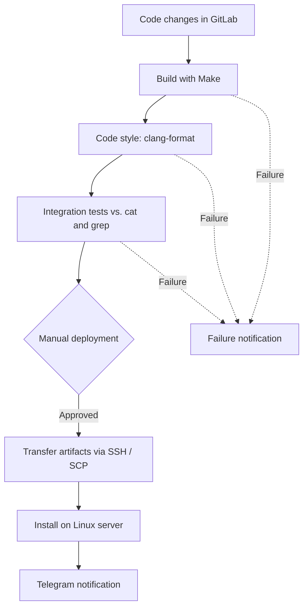
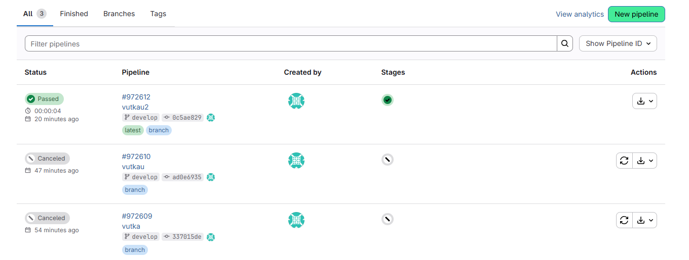
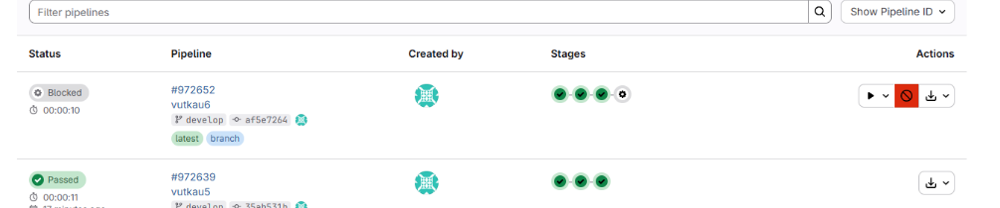

# CI/CD Pipeline for C Utilities


A practical CI/CD project that automates the **build, code-style validation, integration testing, and deployment** of two C command-line utilities: `s21_cat` and `s21_grep`.

The pipeline was developed in **GitLab CI/CD** and uses a self-hosted GitLab Runner, Bash scripts, SSH/SCP, and Telegram notifications. This GitHub repository contains the source and pipeline configuration; **GitHub Actions is not configured**.

## Pipeline architecture



| Stage | Implementation |
| --- | --- |
| **Build** | Compiles `s21_cat` and `s21_grep` with `make`; stores build artifacts for 30 days |
| **Code style** | Runs `clang-format --dry-run --Werror` on C source and header files |
| **Integration tests** | Compares each utility's output with standard Linux `cat` and `grep` on test files |
| **Deploy** | Manually triggered job copies executables through SSH/SCP and installs them on a Linux server |
| **Notifications** | Sends pipeline-related messages through the Telegram Bot API |

## Technology stack

- **CI/CD:** GitLab CI/CD, self-hosted GitLab Runner (Shell executor)
- **Development:** C, GNU Make, Bash
- **Validation:** `clang-format`, shell-based integration tests
- **Infrastructure:** Ubuntu Server, SSH, SCP, Linux permissions
- **Notifications:** Telegram Bot API, CI/CD environment variables

## Repository structure

```text
.
├── .gitlab-ci.yml                 # GitLab pipeline definition
├── src/
│   ├── SimpleBashUtils/
│   │   └── src/
│   │       ├── cat/              # s21_cat source and tests
│   │       └── grep/             # s21_grep source and tests
│   ├── integration_tests.sh       # Behavioral checks against system utilities
│   ├── deploy.sh                  # Manual SSH/SCP deployment
│   ├── notify.sh                  # Telegram notifications
│   ├── report.md                  # Implementation report
│   └── report_images/            # Screenshots of the original lab runs
└── README.md
```

## Run locally

**Prerequisites:** Linux (or WSL), GCC, GNU Make, Bash, `diff`, `cat`, and `grep`.

```bash
# Build both utilities
make -C src/SimpleBashUtils/src/cat
make -C src/SimpleBashUtils/src/grep

# Prepare the artifact directory used by the test script
export CI_PROJECT_DIR="$PWD"
mkdir -p src/artifacts
cp src/SimpleBashUtils/src/cat/s21_cat src/artifacts/
cp src/SimpleBashUtils/src/grep/s21_grep src/artifacts/

# Run integration tests
bash src/integration_tests.sh
```

> **Repository migration note:** the source folder was renamed to `src/SimpleBashUtils/`. The old source paths in `.gitlab-ci.yml` and `src/integration_tests.sh` must be updated before the pipeline or local test script can run successfully from the renamed structure.

## Deployment and configuration

The deploy job is **manual**, not an automatic production rollout. It expects a Linux target reachable via SSH and suitable permissions for installation into `/usr/local/bin`.

The notification script reads `TELEGRAM_BOT_TOKEN` and `TELEGRAM_CHAT_ID` from the CI/CD environment; these values must not be committed to Git.

The current `src/deploy.sh` also contains a fixed deployment username and IP address. They should be replaced with CI/CD variables before reusing the deployment process in another environment. The notification text should also be aligned with the actual outcome of the optional manual deployment.

## Demonstration

The following screenshots document runs of the original GitLab pipeline. They do not represent a live GitHub Actions workflow.

**Build stage completed in GitLab:**



**Manual deployment stage:**



More implementation details and evidence: [Technical report](src/report.md).

## Planned improvements

- [ ] Fix paths following the `SimpleBashUtils` directory rename.
- [ ] Replace hard-coded deployment settings with protected CI/CD variables.
- [ ] Improve notification logic so success messages match completed stages.
- [ ] Add checks for Bash scripts (for example, ShellCheck).
- [ ] Introduce a separate GitHub Actions workflow for GitHub-hosted CI.

## Project background

This project originated as an educational CI/CD assignment at **School 21**. The repository is being adapted for a DevOps/SRE portfolio; the original Git history and author attribution are retained.
