# DO6 — CI/CD

Краткий отчет по настройке CI/CD для проекта SimpleBashUtils. Все основные действия и результаты подтверждены скриншотами.

## Part 1. Setting up the gitlab-runner

- Поднята виртуальная машина Ubuntu Server 24.04 LTS для GitLab Runner.
- Установлен и запущен `gitlab-runner`; для совместимости с сервером GitLab использована ветка Runner 18.11.
- Runner зарегистрирован в проекте `DO6_CICD` с именем `do6-runner` и исполнителем `shell`.
- **Скриншот 1 — работа зарегистрированного GitLab Runner и использование Shell executor.**

  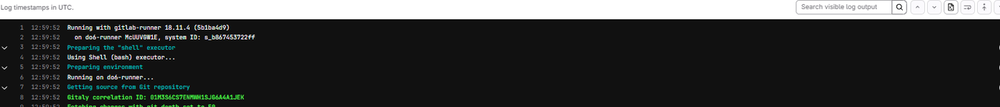

- **Скриншот 2 — зарегистрированный runner `do6-runner`, URL GitLab и executor `shell`.**

  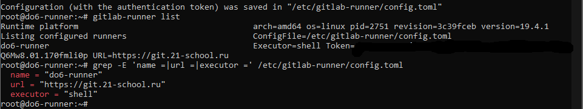

## Part 2. Building

- В `.gitlab-ci.yml` добавлен этап `build`.
- На этапе сборки через Makefile собираются приложения `s21_cat` и `s21_grep`.
- Полученные исполняемые файлы копируются в `src/artifacts/`.
- Результаты сборки сохраняются как GitLab artifacts со сроком хранения 30 дней.
- При ошибке сборки job завершается с ненулевым кодом и pipeline получает статус `Failed`.
- **Скриншот 1 — сборка `s21_cat` и `s21_grep` и подготовка artifacts.**

  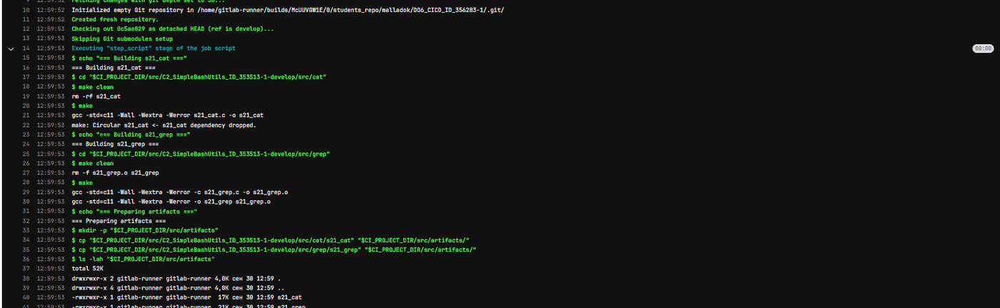

- **Скриншот 2 — успешное завершение build pipeline со статусом `Passed`.**

  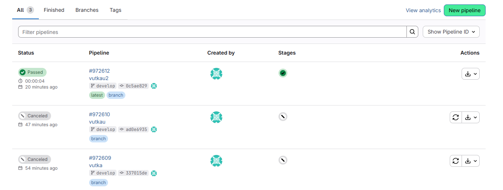

## Part 3. Codestyle test

- В pipeline добавлен этап `codestyle`, выполняемый после успешного `build`.
- Для проверки исходного кода используется `clang-format`.
- Проверка выполняется для `.c` и `.h` файлов проектов `s21_cat` и `s21_grep` с параметрами `--dry-run --Werror --style=file`.
- Если форматирование не соответствует правилам, `clang-format` возвращает ошибку и pipeline завершается неуспешно.
- **Скриншот 1 — последовательность стадий `build` и `codestyle`, обе завершены успешно.**

  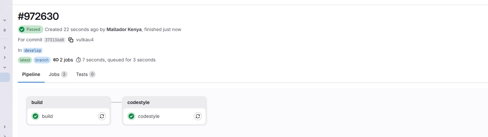

- **Скриншот 2 — вывод `clang-format` для `s21_cat` и `s21_grep`, проверка завершена успешно.**

  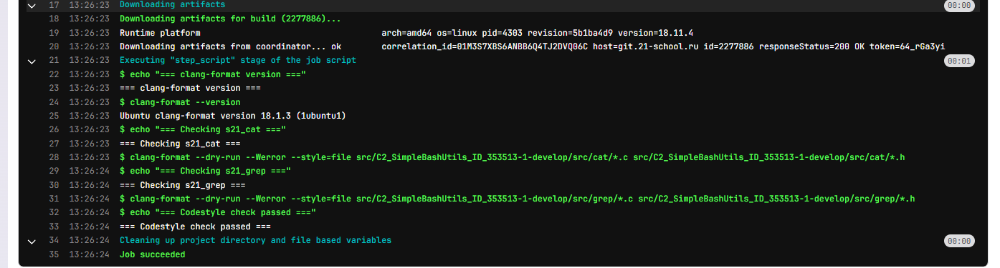

## Part 4. Integration tests

- В pipeline добавлен этап `integration_tests`.
- Этап запускается только после успешного прохождения `build` и `codestyle`.
- Для интеграционной проверки используется скрипт, который запускает собранные `s21_cat` и `s21_grep` на тестовых данных и сравнивает результат с системными утилитами `cat` и `grep`.
- Для каждого кейса в лог выводится результат `PASS` или `FAIL`; при наличии хотя бы одного `FAIL` скрипт возвращает `exit 1`.
- **Скриншот 1 — pipeline с тремя последовательными этапами: `build`, `codestyle`, `integration_tests`.**

  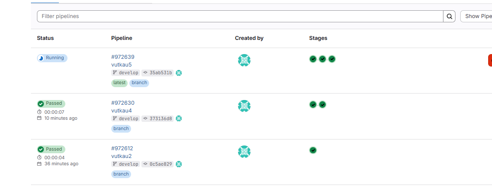

- **Скриншот 2 — результаты интеграционных тестов `s21_cat` и `s21_grep`; тесты завершены успешно.**

  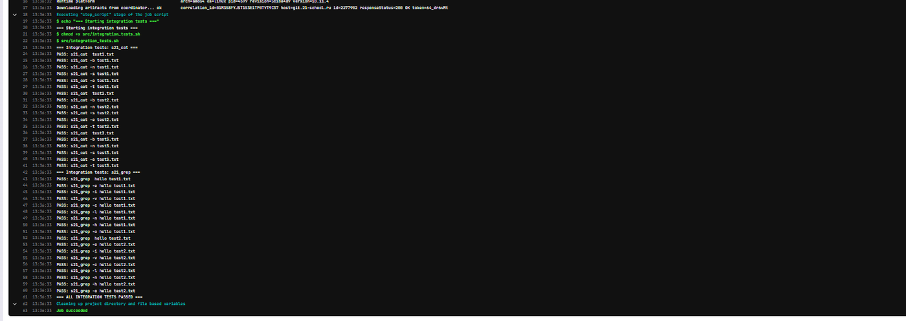

## Part 5. Deployment stage

- Поднята вторая виртуальная машина Ubuntu Server 24.04 LTS, выполняющая роль production-сервера.
- В `.gitlab-ci.yml` добавлен этап `deploy` с ручным запуском (`when: manual`).
- Deploy становится доступен только после успешного прохождения предыдущих CI-этапов.
- Для пользователя `gitlab-runner` настроен SSH-доступ к production-серверу по ключу.
- Скрипт `src/deploy.sh` получает artifacts после сборки, копирует `s21_cat` и `s21_grep` по `scp` во временный каталог production-сервера, после чего устанавливает их в `/usr/local/bin`.
- При ошибке SSH, SCP или установки скрипт завершает job с ошибкой.
- После выполнения задания сохранены snapshots обеих виртуальных машин; snapshots в Git не загружались.
- **Скриншот 1 — deploy ожидает ручного запуска после успешного прохождения CI.**

  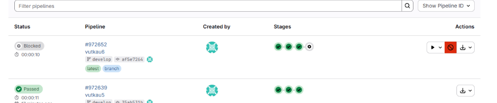

- **Скриншот 2 — успешное копирование и установка бинарных файлов на production-сервер.**

  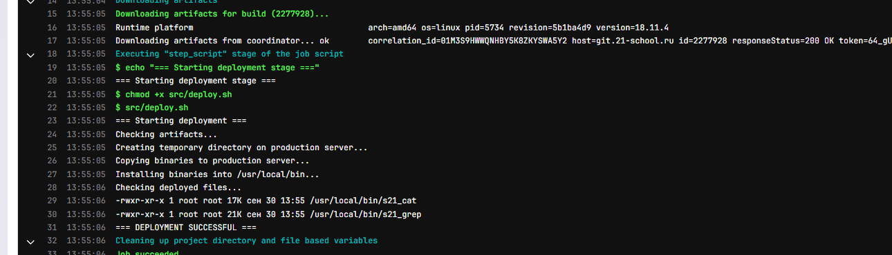

- **Скриншот 3 — проверка `s21_cat` и `s21_grep` непосредственно на production-сервере из `/usr/local/bin`.**

  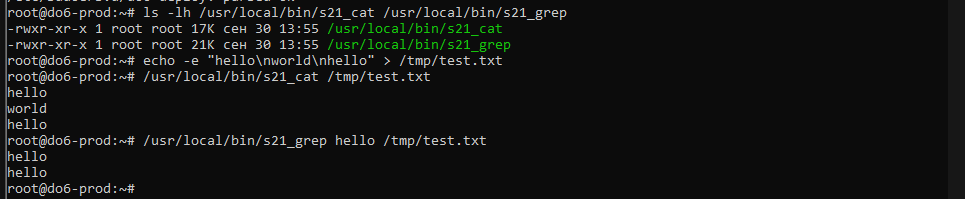

## Part 6. Bonus. Notifications

- Создан Telegram-бот `malladok DO6 CI/CD` для уведомлений о состоянии pipeline.
- Токен бота и `chat_id` не хранятся в репозитории; они передаются job через окружение GitLab Runner.
- В pipeline добавлены jobs `notify_success` и `notify_failure`.
- Успешное уведомление содержит результаты как CI-этапов (`build`, `codestyle`, `integration_tests`), так и CD-этапа (`deploy`).
- **Скриншот 1 — успешное выполнение `notify_success` и отправка сообщения в Telegram.**

  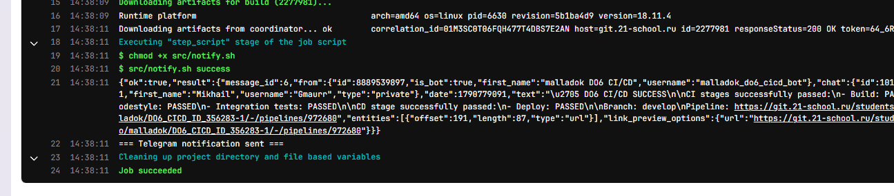

- **Скриншот 2 — Telegram-уведомление об успешном прохождении CI и CD.**

  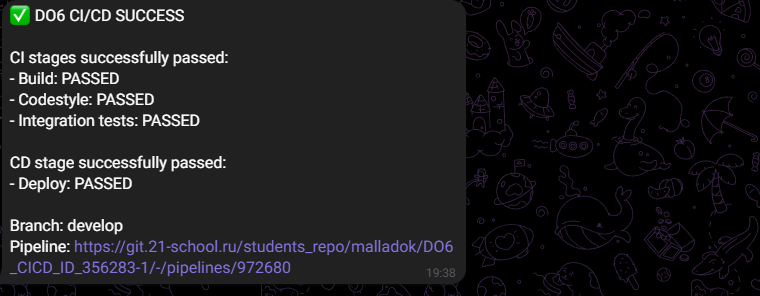
